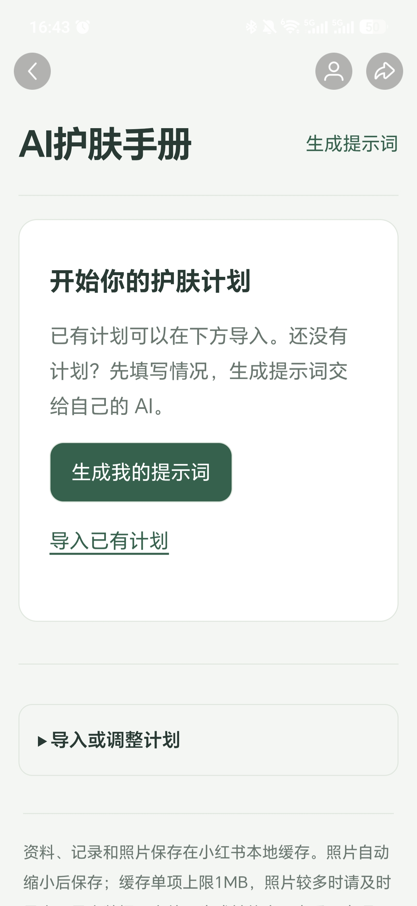
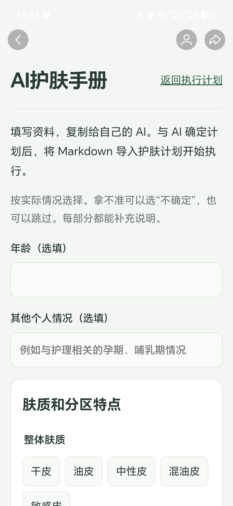
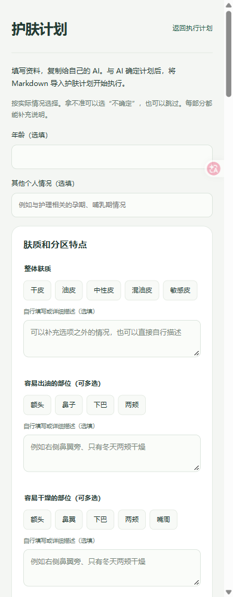
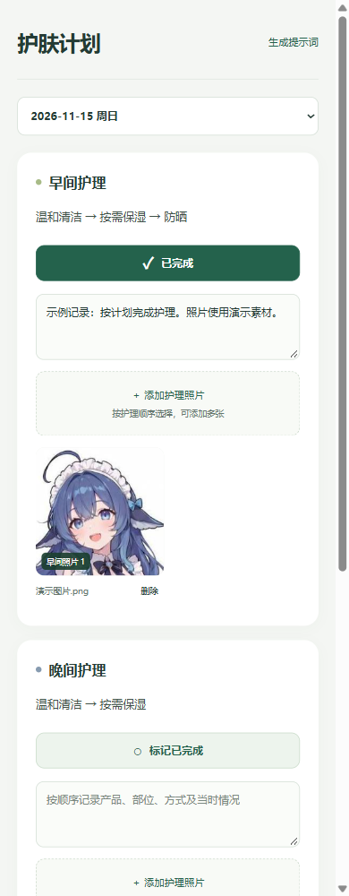

# AI护肤手册

把确定好的护肤计划变成每天可以执行、记录和回顾的日历。

AI护肤手册 是一个H5项目，用于制定你个人的护肤计划以及护肤治疗过程记录，包含**提示词生成**和**护肤计划执行**。先填写表单说明个人情况，系统会为你生成一个提示词，复制提示词给自己使用的 AI，让其按格式生成一份护肤计划；与 AI 确定计划后，导入 Markdown 文件，就可以开始每天的护理任务啦。
后续有预算会逐渐增加一体化AI定制护肤计划，AI分析护肤情况等功能。

## 在小红书中使用

[打开小红书小工具「AI护肤手册」](https://www.xiaohongshu.com/s/poster?bgimg=https%3A%2F%2Fsns-redskillhub-s1.xhscdn.com%2Fred_app_image%2F1040g4m8327j97nuq7g605ol4ao6oc1d33k3kkqo%3Fsign%3Dce72657e3b274731ef28db02faeb7f71%26t%3D6cdaa41e&xhsshare=&appuid=62a4560d00000000210205a3&apptime=1794732189&deeplink=xhsdiscover%3A%2F%2FminiTool%2F6af963d8f2fc360015c34069%3Fsource%3Dh5%26page_key%3D28%26xhsMpScreenMode%3Dfull%26share_id%3Df55684b92e38481bbe5e346f3907dfc3%26share_channel%3Dcopy_link)

建议在手机上打开分享链接，并按页面提示进入小红书使用。

1. 点击“生成提示词”，填写自己的情况，长按生成的文本选择并复制给自己的 AI。
2. 与 AI 确定计划后，将 Markdown 全文粘贴到“导入或调整计划”，保存后开始打卡。
3. 在护理过程中记录情况、添加照片，通过日历查看完成状态。
4. 需要交给其他应用时，查看导出的 JSON 文本，长按选择并复制。

小红书版支持粘贴计划和选择照片，计划导入使用文本粘贴，导出使用 JSON 文本。资料和记录保存在当前设备的小红书本地缓存中，与网页版分别保存。清理应用数据前请先导出。

### 小工具实机截图

<table>
<tr>
<td></td>
<td></td>
</tr>
<tr><td>小工具首页</td><td>填写情况与生成提示词</td></tr>
</table>

## 页面预览

<table><tr><td></td><td></td></tr><tr><td>填写情况，生成提示词</td><td>执行计划，记录文字与照片</td></tr></table>

## 可以做什么

- 勾选肤质、皮肤表现、改善目标和日常习惯，每个小问题都可以补充说明。
- 逐件填写产品使用经历，按选择展开过敏、用药和治疗详情。
- 生成可复制的提示词，让自己使用的 AI 核对产品信息、整理护理计划并提供来源。
- 从文件或粘贴文本导入 Markdown 护肤计划，按日期查看早晚步骤及当天提醒。
- 标记早晚护理完成，填写护理方式、皮肤感受和当天其他情况。
- 添加多张照片，手机上以两列缩略图展示，点击查看完整大图。
- 导出包含计划、完成状态、文字及照片数据的 JSON，交给医生或其他应用查看。

## 使用过程

### 1. 准备计划

打开首页。如果还没有计划，点击“生成提示词”，选择实际情况，填写现有产品。

产品版本、规格和官网链接可以留空。提示词会要求 AI 查询相关产品、列出网页来源，并在版本无法确定时向你确认。

点击“复制提示词”，粘贴到自己的 AI 应用中。根据问答完善资料，确认最终方案，然后保存为 Markdown 文件。

### 2. 导入 Markdown

回到执行计划页，在底部展开“导入或调整计划”，选择文件或粘贴文本，点击“保存计划”。

逐日日历需要使用下面的列顺序，日期采用 YYYY-MM-DD。每一天单独占一行，早晚单元格写清具体操作。

```markdown
# 我的护肤计划

| 日期 | 星期 | 早上怎么用 | 晚上怎么用 | 当日提醒 |
|---|---|---|---|---|
| 2026-11-15 | 周日 | 温和清洁 → 按需保湿 → 防晒 | 温和清洁 → 按需保湿 | 示例内容，请替换为自己的计划 |
| 2026-11-16 | 周一 | 按已确认的早间计划护理 | 按已确认的晚间计划护理 | 记录当天皮肤感受 |
```

表格之外可以包含产品说明、每周安排和注意事项，导入后可在页面底部查看完整计划。

### 3. 护理与拍照

选择日期，查看早晚护理内容。做完后点击“标记已完成”，再次点击可撤销。

在说明框记录产品、部位、使用方式和当时感受。点击“添加护理照片”，按护理顺序选择一张或多张图片，也可以继续追加。缩略图下可以删除单张照片。


示例素材位于 [docs/demo-upload.png](docs/demo-upload.png)，可用于本地体验图片选择功能。截图中的示例照片通过演示记录填入；实际原生文件选择仍需在自己的设备上验证。

### 4. 记录变化与导出

在“当天其他情况”填写产品用完、过期、未补涂防晒或治疗记录等事项。

点击“导出计划、记录和照片 JSON”下载数据，再自行提供给医生或其他 AI。根据反馈调整计划后，可以重新导入。当前完成记录按日期保存，导入相同日期的计划会继续显示该日期原有记录。

## 数据保存

资料、计划、照片和记录保存在当前设备的浏览器中，项目没有接收这些数据的存储后端，也没有自动分析服务。

换设备、换浏览器或清除网站数据前，请先导出。当前尚未提供 JSON 恢复导入与跨设备同步。照片以 Data URL 写入 localStorage，较多或较大的照片可能达到浏览器容量上限，保存失败时页面会提示。

早期静态版数据与 React 版采用不同存储结构，目前尚未自动迁移。

本项目提供计划整理、执行记录和数据导出工具。护理方案及其他 AI 的分析结果需要用户结合实际情况和专业意见判断；有医生要求时，应将其提供给制定计划的 AI。

## 本地运行

需要 Node.js 22 或以上版本和 npm。

```bash
npm install
npm run dev
```

浏览器打开终端打印的本地地址。

```bash
npm run build
```

构建产物位于 dist/，可以部署到支持静态网页的托管服务。

## 发布与版本记录

当前 npm run deploy 使用 Codex CLI 与 Sites 插件更新 .openai/hosting.json 指定的站点，需要自己的登录环境和站点配置。克隆项目后请先配置自己的站点 ID。

发布前修改 package.json 的版本号，填写 releases/<版本号>/changes.md，然后运行：

```bash
npm run deploy -- --dry-run
npm run deploy
```

成功发布后，版本目录保存更新说明、部署包及部署结果。详情见 [发布记录说明](releases/README.md)。node_modules/、dist/ 和部署压缩包由 Git 忽略。

## 项目结构

```text
src/
  main.jsx          # 首页、计划执行、照片预览与导出
  PromptForm.jsx    # 情况表单与提示词资料生成
  style.css         # 响应式样式
docs/               # README 截图与演示素材
scripts/            # 部署脚本
releases/           # 版本说明与发布记录
ai/                 # 项目知识、状态与 AI 工作日志
AGENTS.md           # AI 协作约定
```

## 当前范围与后续改进

当前导出格式为 JSON，计划日历支持标准日期表格。后续可以完善旧数据迁移、照片存储容量、逐步骤记录及更多导出格式。

欢迎提交问题与改进建议。提交截图、计划或导出记录时，请先移除自己的健康资料和个人照片。仓库的代码许可证尚未确定，示例图片的权利独立于项目代码。

## GitHub 提交

提交信息使用类型前缀和中文说明，例如 feat: 新增护理月历、fix: 修复日期展示。
